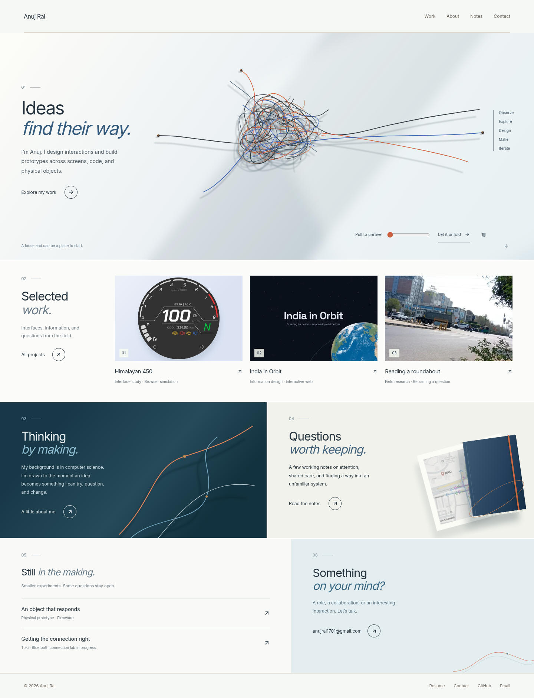
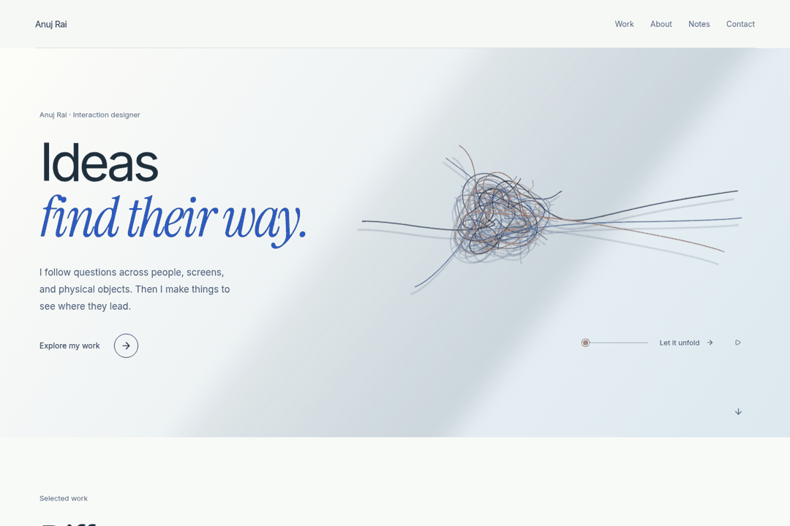

# Anuj Rai — interaction design & making

A portfolio exploring screens, code, physical objects, and the space between them.

The `design/skein` direction uses a gathered skein that a visitor can pull open. Chalk white, ink blue, and burnt orange replace the earlier beige treatment. Real project artifacts stay in the foreground.



## Try the movement

The range control supports pointer, touch, and keyboard. “Let it unfold” opens the strands; “Gather again” brings them back. The three pins hold while free ends find separate paths. This is a browser-rendered illustration, not a photograph.



## Run locally

Use Node.js and npm, then:

```sh
npm ci
npm run dev
```

For the production version:

```sh
npm run build
npm run start
```

## Structure

- [Homepage](app/page.tsx) and [its composition styles](app/studio.module.css).
- [Skein drawing and interaction](components/portfolio/ThreadStudy.tsx).
- [Art direction and evidence boundaries](docs/thread-direction.md).
- Work and the existing case-study routes use genuine available project media.
- About, working Notes, Resume, and Contact remain direct destinations.

The independent medicine-care app and physical group Meditimer are separate projects. Smaller experiments retain their current status. No project metrics, findings, or outcomes are invented for this presentation.

## Verification

Production build, TypeScript, lint, and whitespace checks pass. Browser review covers thirteen routes at 1440, 768, 390, and 320px, plus unwind/gather, pinned endpoints, keyboard input, pause/resume, offscreen suspension, reduced motion, focus navigation, research disclosure, 404s, and static content without JavaScript.

The branch is for review. It has not been merged into main.
